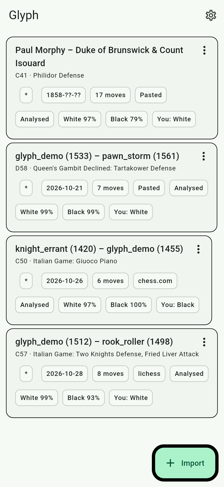
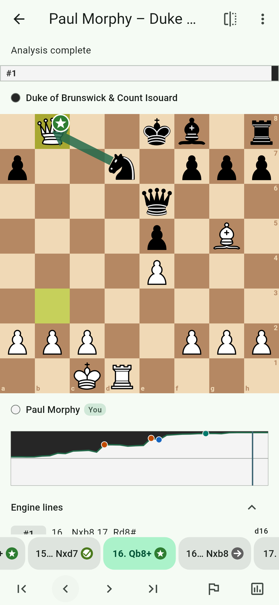
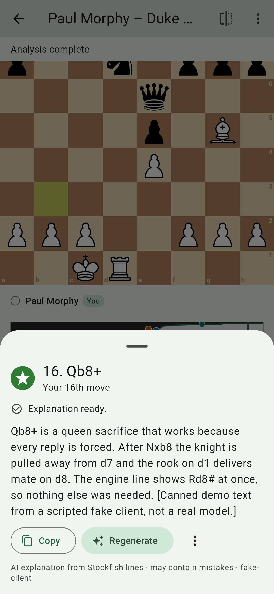
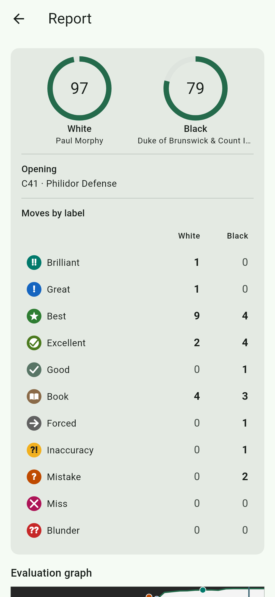
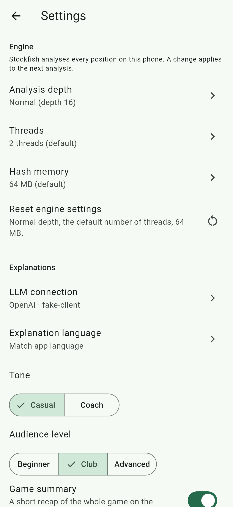

# Glyph

On-device Stockfish game review for Android, with optional LLM-written move explanations.

Glyph imports a chess game, runs Stockfish on your phone over every position, labels each move (Brilliant `!!`, Great `!`, Best, ... Blunder `??`, Miss), and shows the result on a lichess-style analysis board. Tap **Explain** on a move and Glyph sends the engine's numbers and lines to an LLM you configure, which writes a short plain-language reason.

**The engine judges, the LLM narrates.** The model never evaluates a position and is never asked to invent variations: it only receives facts computed by Stockfish and deterministic code (SAN lines, evaluations, material, hanging pieces).

Status: version 0.1.0, **not released yet**. See [Known limitations](#known-limitations).

| Library | Analysis board | Explain |
|---|---|---|
|  |  |  |

| Report | Settings |
|---|---|
|  |  |

*How these were made:* `app/test/screenshots/screenshots_test.dart` renders the real app in Flutter's test renderer (real fonts, real piece images) over **recorded** Stockfish output, run through the real analysis, classification and accuracy code. The Explain and summary texts are **canned strings from a scripted fake client** (the model name shows as `fake-client`), not output of a language model. They were not taken on a phone. Regenerate with `cd app && flutter test --run-skipped --tags screenshots test/screenshots`.

## Features

- **Import**: paste PGN (live validation, multi-game picker, errors name the game, move and SAN), open a `.pgn` file, Android Share / "Open with" for text and files, last 30 games of a lichess or chess.com user.
- **Library** with analysis status, accuracy chips and swipe-to-delete with undo.
- **Analysis**: whole game at Fast (depth 12) / Normal (16) / Deep (20), MultiPV 2; progress, cancel, resume after cancel, background or app kill. Badges fill in while it runs.
- **Classification**: Book, Forced, Brilliant, Great, Best, Excellent, Good, Inaccuracy, Mistake, Miss, Blunder.
- **Report**: accuracy per player, label counts, opening (ECO and name), eval graph, key moments.
- **Board**: badge on the destination square, best-move arrow, eval gauge, top two engine lines, move list, swipe / buttons / keys, flip, player strips with clocks (when the PGN has `[%clk]`), automatic orientation to your side.
- **Explain**: streamed, cached explanation of any move (View prompt, Copy, Regenerate), plus an optional game summary (casual or coach tone).
- **Export**: annotated PGN through the share sheet.
- Fully usable offline except Explain, summary and online import. No account, no telemetry.

## How classification works

Everything is deterministic code over stored engine lines; every constant is in `ClassifierConfig` (`packages/glyph_core/lib/src/classify/`).

1. **Win%.** Centipawns become a win chance with lichess's curve, `50 + 50 * (2 / (1 + exp(-0.00368208 * cp)) - 1)`. As in lichess's server code (scalachess `eval.scala`), cp is clamped to +-1000 and every forced mate counts as +-1000 cp. All engine scores are converted to White's point of view at one place and to the mover's point of view only inside the classifier.
2. **Expected-points loss** of a move: `max(0, (Win% of the best line before - Win% after the move) / 100)` from the mover's side. If the move is the engine's first or second choice, its score comes from the same search, so the best move always has loss 0. Bands:

   | Label | EP loss |
   |---|---|
   | Best | 0 (the engine's top move) |
   | Excellent | up to 0.02 |
   | Good | 0.02 to 0.05 |
   | Inaccuracy | 0.05 to 0.10 |
   | Mistake | 0.10 to 0.20 |
   | Blunder | above 0.20 |

3. **Special labels**, first match wins: Book, Forced, Brilliant, Great, Miss, then the bands.
   - *Book*: standard start, every earlier ply was Book, and the position after the move is in the bundled lichess `chess-openings` set (matched by position, so transpositions count).
   - *Forced*: exactly one legal move.
   - *Brilliant*: loss <= 0.02, a real **sacrifice** by static exchange evaluation (trades and recaptures do not count), you are not worse afterwards (Win% >= 50) and were not already winning (<= 97).
   - *Great*: the played move is the engine's top move, the second-best line is at least 20 Win% points worse, the outcome bucket (losing / unclear / winning) changes between them, and it is not an obvious recapture.
   - *Miss*: you gave back most of an opponent error (both losses >= 0.10), or missed a forced mate in 5 or fewer with loss >= 0.05; a move that is also a Blunder into a worse position stays a Blunder.
4. **Accuracy** is lichess's `AccuracyPercent` algorithm (volatility-weighted mean averaged with a harmonic mean over sliding windows). It reproduces the integer accuracy lichess reports on all 80 player-results of the 40 server-analysed lichess games in the test vectors.

**This approximates chess.com's published idea; it does not copy it.** The loss thresholds are those chess.com publishes for its expected-points model, but they are applied on lichess's open Win% curve (chess.com's own curve is rating-dependent and unpublished), and Brilliant, Great and Miss use Glyph's own rules. Glyph's labels will differ from chess.com's Game Review on some moves. Glyph has its own badge icons and does not use chess.com's name, icons or model.

## Setting up explanations

Explain and the game summary need an **OpenAI-compatible Chat Completions** endpoint (`POST {base URL}/chat/completions`, streamed; the OpenAI Responses API is not used). Open **Settings > Explanations > LLM connection**, pick a provider (it fills in the address), enter a model name, save a key if the provider needs one, and press **Test connection**.

| Provider | Base URL | Key | Notes |
|---|---|---|---|
| OpenAI | `https://api.openai.com/v1` | required | enter a model name you have access to |
| OpenRouter | `https://openrouter.ai/api/v1` | required | model ids look like `vendor/model` |
| Ollama (your computer) | `http://<computer-ip>:11434/v1` | not needed | the preset fills `http://localhost:11434/v1`; replace `localhost` with your computer's address (on a phone, `localhost` is the phone itself) |
| LM Studio (your computer) | `http://<computer-ip>:1234/v1` | not needed | enable "serve on local network" in LM Studio |
| Custom | any `https://` address, or private `http://` | optional | llama.cpp server and others |

- **Plain `http://`** is allowed only for `localhost`, `127.0.0.0/8`, `10/8`, `172.16/12`, `192.168/16`, `100.64/10` (Tailscale) and `.local` / `.lan` names. Any other `http://` address is refused with a clear message.
- **Key binding.** The API key lives in Android Keystore-backed secure storage, one slot per provider, shown only as `••••abcd`. It is bound to the address (scheme, host, port) it was saved for: change the address and the key is not sent there until you save it again. Over plain `http://` the key is sent only after you turn on *Send the key over unencrypted http* for that address. OpenAI and OpenRouter addresses are fixed; to use another address pick Custom.
- No `temperature` or token-limit parameter is sent by default. If a model rejects `max_tokens`, set *Token limit parameter* to `max_completion_tokens` (or none).

## Privacy

No account, no analytics, no crash reporting, no server of Glyph's own. Games and analyses stay on the phone and are excluded from Android backups. The app talks only to `lichess.org` and `api.chess.com` when you fetch games (your username in the URL, a generic `Glyph/<version>` User-Agent) and to the LLM server you configure when you ask for an explanation. Prompts contain FENs, SAN lines, evaluations and labels, never names, usernames, ratings, sites, dates or event names. The release APK requests only `INTERNET` (plus a signature-level permission AndroidX adds for itself). Details: [docs/PRIVACY.md](docs/PRIVACY.md).

## Interoperability

| Direction | Source | Status |
|---|---|---|
| Import | lichess web export, API export (with `[%eval]` / `[%clk]` / opening), lichess app share | golden tests on real and synthetic files: full mainline and headers |
| Import | chess.com download, API monthly archive, chess.com app share text (with the share preamble) | golden tests: full mainline and headers |
| Import | multi-game files (up to 500 games), BOM, CRLF, variations, NAGs, nested braces, Chess960 and `[FEN]` starts | golden tests; mainline only is kept; other variants are rejected with a message |
| Import | lichess by username (NDJSON stream, last 30), chess.com by username (archives newest-first, `ETag` cache) | tested against local fake servers, and once by hand against the real APIs |
| Export | annotated PGN: original headers, `[%eval]`, `[%clk]`, NAGs (`$3 $1 $6 $2 $4`; Miss is `$2` plus a `{ Miss }` comment), `[Annotator "Glyph"]` | re-import into Glyph gives the same mainline, headers and evals (tested) |
| Export | lichess study "Import PGN" | **not yet checked by hand**; it is on the release checklist |

## Build

Requirements: Flutter **3.47.9** (pinned in `.fvmrc`; `fvm use` or install that version), Dart 3.13, JDK 21 (as in CI), the Android SDK (platform 36). The Android NDK is the one Flutter selects (`flutter.ndkVersion`, 28.2.13676358 for 3.47.9) and Gradle downloads it; `compileSdk` and `targetSdk` are the values Flutter 3.47.9 provides (36); `minSdk` is 26. The build needs network access (the `sqlite3` build hook and the `multistockfish_light` CMake step download files).

```sh
git clone https://github.com/Umar-Haqimi/Glyph.git && cd Glyph
flutter pub get                       # the repo root is a Dart workspace (app + packages/glyph_core)
cd app
flutter build apk --release --split-per-abi
# app/build/app/outputs/flutter-apk/app-{armeabi-v7a,arm64-v8a,x86_64}-release.apk
```

**Signing.** Without a keystore the release build falls back to the Android *debug* key, so it builds and runs but must not be distributed. For a real release provide a keystore either in `app/android/key.properties` (`storeFile` relative to `app/android/`, `storePassword`, `keyAlias`, `keyPassword`; git-ignored) or through the environment variables `GLYPH_KEYSTORE_FILE`, `GLYPH_KEYSTORE_PASSWORD`, `GLYPH_KEY_ALIAS`, `GLYPH_KEY_PASSWORD`. `tool/build_release.sh` builds with `GLYPH_REQUIRE_SIGNING=1` (fails if no keystore is configured), `--split-debug-info`, then verifies the signature (`tool/check_signing.sh`), the permissions (`tool/check_permissions.sh`) and the dependency list (`tool/check_banned_deps.sh`). The full procedure is in [docs/RELEASE.md](docs/RELEASE.md).

**Tests.**

```sh
(cd packages/glyph_core && dart analyze && dart test)   # pure-Dart core: classifier, accuracy, PGN, LLM, online clients
(cd app && flutter analyze && flutter test)             # widget, repository and hygiene tests
bash tool/check_permissions.sh && bash tool/check_banned_deps.sh   # after a release build
```

Tests that need a desktop Stockfish (`STOCKFISH_PATH`) or a device (`app/integration_test`, tag `device`) are skipped by default; how to run them is in [docs/HARDWARE_TEST.md](docs/HARDWARE_TEST.md). The vector commands are in [docs/m0/VECTORS.md](docs/m0/VECTORS.md) (also reachable as `docs/VECTORS.md`).

## Threat model (summary)

Glyph handles untrusted input (PGN text and files, shared content, online API responses, LLM output) and one secret (your API key).

- **Untrusted input is capped:** PGN 2 MB, 500 games per file, 1000 plies per game, 4 KB per comment, 50 online games (30 by default), 1 MB per NDJSON line, 16 MB per response, 32 KB per explanation (1 MB total stream), with connect / first-byte / total timeouts. Each cap has a test. Redirects are never followed.
- **Share intake** goes through a separate UI-less activity that validates the payload, reads it in memory with a watchdog and hands it to the app with a per-process token; the main activity ignores other intents. Deep links are disabled.
- **The API key** is only in secure storage, read per request, bound to its address, never written to SQLite, settings, logs, clipboard, exported PGN or "View prompt". Dart strings cannot be wiped from memory; the short lifetime is the mitigation.
- **LLM output** is rendered as plain text: no web view, links or images. Prompts are SAN-only and contain no personal data.
- **No telemetry, no Play Services**; `tool/check_banned_deps.sh` fails CI otherwise. In release builds nothing from Dart code reaches logcat.
- **Cleartext:** the network security config allows cleartext so that LAN servers work; `BaseUrlPolicy` is the gate (https anywhere, http only for local / private addresses). A device on your network can read an `http://` explanation; the key is not sent that way unless you opt in per address.
- **Backups** are disabled; screen capture is not blocked (nothing sensitive is shown).
- **Out of scope:** a rooted or compromised device, a malicious LLM provider reading the facts you send it, and native crashes inside the engine.

Decisions and sources are in [docs/DECISIONS.md](docs/DECISIONS.md); the spec is [docs/SPEC.md](docs/SPEC.md); progress and the acceptance checklist are in [docs/PROGRESS.md](docs/PROGRESS.md).

## Known limitations

- **Never run on a device yet.** Analysis speed (target 80 plies at Normal in 3 minutes), battery, TalkBack, share / Open-with from the lichess and chess.com apps, and the Kotlin code at run time are unverified. Release builds, host tests and permission checks pass.
- **SSE vectors are synthetic** (built from each provider's documented format); real captures are pending, so behaviour against live OpenAI, OpenRouter and Ollama has not been verified.
- Most classification transcripts were recorded with **Stockfish 16** (the earlier ones with 19), not the engine that ships in the app (Stockfish 19 with the 1.1 MB light network). On-device evaluations will differ slightly.
- Exported PGN has not been imported into a real lichess study yet.
- Android only, standard chess and Chess960, view-only board, English UI, no variation exploration.

## Licence

GPL-3.0-or-later, see [LICENSE](LICENSE). Glyph links GPL software (Stockfish, multistockfish, chessground, dartchess), which requires this licence.

## Credits

- [Stockfish](https://stockfishchess.org) (GPL-3.0) through [multistockfish](https://github.com/lichess-org/dart-multistockfish) by lichess.org (GPL-3.0). The embedded network is trained on [Leela Chess Zero](https://lczero.org) training data, which is available under the Open Database License (ODbL).
- [chessground](https://github.com/lichess-org/flutter-chessground) (GPL-3.0, vendored in `third_party/chessground` with non-free assets removed) and [dartchess](https://github.com/lichess-org/dartchess) (GPL-3.0) by lichess.org.
- [chess-openings](https://github.com/lichess-org/chess-openings) (CC0) for opening names and Book detection.
- lichess.org for the Win% and accuracy formulas (lila and scalachess, studied and reimplemented), and the free game APIs; chess.com for its public API and the published expected-points thresholds.
- Piece sets: cburnett (Colin M. L. Burnett, GPL-2.0+), merida (Armando Hernandez Marroquin, GPL-2.0+), mpchess (Maxime Chupin, GPL-3.0+), rhosgfx (Rhosgfx, CC0). Board textures from lichess (AGPL-3.0+). Badges and launcher icon are Glyph's own.
- Full list with licences and sources: [docs/ASSETS.md](docs/ASSETS.md) and the in-app About screen.

Source: <https://github.com/Umar-Haqimi/Glyph>
